# Emulator verification pass

Two passes are recorded here. **[Batch 5 rerun](#batch-5-rerun)** is the current result, on
`fix/batch-5`, after the fixes for the bugs the first pass found. The
**[original pass](#original-pass-testemulator-pass)** below it is kept as found, on
`test/emulator-pass` at `9fe1d01`, because its bug list is what batch 5 fixed.

## Round 6: emulator boot (UI redesign)

In UI round 5 the API 34 AVD (`yoma_api34`) crashed during cold boot three times in a row
(exit 139, a segfault in the emulator process). That happened on the NVIDIA GPU (`-gpu
host`) with `-no-snapshot-save`, with `-no-snapshot`, and with `-no-snapshot -feature
-Vulkan`.

**What changed since UI round 4, when it worked:** nothing that could be found.

| Item | Value |
|---|---|
| NVIDIA driver (`nvidia-smi`) | 580.178.04, unchanged; NVIDIA OpenGL 4.6 works (`glxinfo -B` with PRIME offload) |
| apt (`/var/log/apt/history.log`) | Last run 2026-11-07 18:26, before round 4. Nothing touching nvidia, mesa or the kernel since. The last kernel change was `linux-generic-hwe-24.04` 7.0.0-42 → 7.0.0-43 on 2026-11-06, but the machine still runs 7.0.0-42 |
| Emulator | 37.2.13.0 (build 16740729), installed 2026-11-06/07, unchanged |
| KVM | `emulator -accel-check`: KVM 12 usable |
| Memory at the round-5 failures | about 3.3 GB free, swap about 3.2 / 4 GB used |
| Memory at the round-6 tries | about 6.4 GB free (8 GB available), swap 3.7 / 4 GB used |

**Tried in order, stopping at the first that booted 3 times in a row:**

1. **`-gpu host -no-snapshot-load` (cold boot, no snapshot loaded): 3/3**, in 40 s, 36 s and
   39 s, still on the NVIDIA GPU. Software rendering (`-gpu swiftshader_indirect`) and
   `-wipe-data` were not needed.

The runs used `scratchpad/boot3.sh`: boot, wait for `sys.boot_completed`, `adb emu kill`, three
times. Stale `*.lock` files in the AVD folder were removed before each boot.

**The cause is not proven.** The flag that differs from the crashing runs is snapshot
*saving*: `-no-snapshot` turns off both loading and saving, and the log of the crashing runs
shows the quick-boot machinery ("Feature QuickbootFileBacked is disabled…") just before the
crash. Free memory was also about 3 GB lower then.

**What `scripts/run_emulator_pass.py` does now:** it uses `-no-snapshot-load` instead of
`-no-snapshot` and removes stale AVD lock files before booting.

## Round 7: emulator deaths mid-run

The host-GPU boot fix above held: every boot succeeded. During the round-7 regression,
though, the API 34 emulator died about ten times and API 24 once.

- **When:** mostly at the end of a scenario, and during scenario 2's long YAMNet recording
  and analysis.
- **Cause:** `systemd-oomd` (`oomctl`). It kills a process group when memory pressure on
  the user session stays above 50% for 20 s. Swap on this 13 GB host stays near 90%, and a
  Gradle build next to the emulator crossed the limit. The same mechanism killed the agent's
  own session twice.
- **What the script does now:**
  - 2 GB for API 34, like API 24;
  - Gradle capped at 3 GB;
  - the Gradle daemon stopped after every scenario's build;
  - each scenario in its own try, with the emulator booted again if it has gone; deaths are
    listed at the end of the run.
- **Still unresolved:** scenario 2's ANR probe and, on API 34, the release timings did not
  complete. Running them needs more free memory: close other heavy apps first, or use a
  machine with more RAM.
- **Results:** in `docs/audit/UI_REDESIGN.md`, round 7, step 6.
- **Stale references:** three lines in the older sections below still name screenshots that
  were removed in round 7 (`9415e0c`).

## Batch 5 rerun

Date: 2026-11-07. Branch `fix/batch-5`, app at `b3d3b2f` plus test-only commits up to `f046c2b`.
Same AVDs, toolchain and mock backend as the original pass. The API 34 AVD now runs with 3 GB
(see [Devices](#devices)).

| # | Scenario | API 34 | API 24 (2 GB) |
|---|----------|--------|---------------|
| 1 | YAMNet on the device; OPERA-CE says it isn't in this build | PASS | PASS |
| A1 | Screen keeps drawing and answering taps during analysis (new) | PASS | PASS |
| 2 | Release: plain build refused, test build labelled, no OPERA-CE files, mic denied → INCONCLUSIVE, no ANR | PASS | PASS |
| 3 | CHO setup | PASS | PASS |
| 4 | Full referral, USSD accept and arrival | PASS | PASS |
| 5 | Skip vitals | PASS | PASS |
| 6 | Offline; after Call or SMS the CHO is asked first; without, the screen follows the send | PASS | PASS |
| 7 | Stale referral prompt | PASS | PASS |
| 8 | Backend restart mid-cascade | PASS | PASS |
| 9 | 320×568 dp: screens 3–7 and Home with every warning | PASS | PASS |
| 9+ | Home with every warning at the device's own size (411 / 360 dp) | PASS | PASS |

**Where these results come from.** The full pass ran 14:20–16:00. It failed s2, s6 and the
banner tests on both AVDs; each is explained below, and those scenarios were rerun after the
fixes (16:04–17:50). Scenarios 1, A1, 3, 4, 5, 7, 8, timings and the 320 dp runs of 3, 4, 5 and
7 are from the full pass. In the reruns, API 24's s7 and banner tests failed once because the
host lost DNS and Gradle couldn't fetch a dependency, and s6 at 320 dp failed once because
`uiautomator` returned a partial screen dump to the runner; both were rerun and passed, and the
runner now retries a partial dump.

**What the full pass found, and what was done:**

1. **s2: the "TEST BUILD — not for patient use" label was drawn but missing from the
   accessibility tree,** so TalkBack wouldn't read it. A real app bug: the route blocked the
   semantics of what was painted before it. Fixed in `b3d3b2f`, with a widget test.
2. **s6 expected the old behaviour.** The CHO taps Call and SMS while offline, so with B2 the
   server now holds the referral and asks "Still needs transport?" instead of dispatching. The
   test now checks that, answers Send now, and then queues a second referral with no Call or SMS
   to check the screen moves on to drivers notified by itself (A4).
3. **The banner tests never saw the catalog warning.** The harness "restarted" the app by
   calling `main()` again, which kept Home's state. It now unmounts the app first.

### Bugs from the original pass

| Original bug | Batch 5 | On the emulators now |
|---|---|---|
| B2. Analysis blocks the main thread; ANR | A1, `cb946d1` | Longest block 194 ms (API 34) and 148 ms (API 24), against 5,810 and 10,618 ms before. A tap one second in is handled. No ANR in 6 probe runs per AVD, where API 34 had 7 in 8 |
| B3. Banners push Emergency Referral off Home | A2, `f548e70` | Fully visible and tappable with every warning, open and closed, at 320 dp and native size on both |
| B4. OPERA-CE "isn't installed" | A5, `bbafabe` | Not bundled; says "OPERA-CE is not included in this build" |
| B5. Queued screen stale after an automatic send | A4, `cd9985a` | Follows the send to drivers notified, or to the question |
| B6. Raw exception on the dispatch screen | A4 | Plain message with Call and SMS (s8) |
| B7. Release defaults to development | A3, `25538ec`, `b3d3b2f` | A plain release refuses to build; the test release is labelled on every screen |
| B8. 96.6 MiB APK | A5 | 25.1–33.6 MB per ABI; no OPERA-CE file |
| B10. Raw microphone error | A4 | "Microphone permission is off." with the way to fix it |
| B1 (build fix), B9, B11, B12 | not in batch 5 | Unchanged |

### A1: responsiveness

Test: `integration_test/s10_responsive_test.dart`, debug build, a full 15 s capture through the
real YAMNet, with a spinner on screen, a 10 ms timer on the main isolate, and a tap one second in.
The control runs the same screen, timer and tap without inference.

| | API 34 | API 24 |
|---|---|---|
| Longest main-thread block, before A1 | 5,810 ms; tap not handled | 10,618 ms; tap not handled |
| Longest main-thread block, after | **194 ms**; tap handled | **148 ms**; tap handled |
| The control, no inference | 412 ms | 182 ms |
| Frames drawn during analysis | 507 (18.8 per second) | 419 (32.2 per second) |
| Analysis time with the spinner running | 26.9 s | 13.0 s |
| Analysis time with nothing on screen (s1, 3 runs) | 5.5, 10.3, 6.8 s | 5.3–5.6 s |

The remaining blocks are no longer than the control's, so they come from the test itself (frame
pumps and the tap in a debug build), not inference. Analysis takes longer while the screen
animates. These emulators render in software on the same CPU, which may explain it; only a phone
can tell.

### A2: Home with every warning

`s9_home_banners_test.dart` raises all five warnings at once (failed, stale, expiring, retry, and
a real stale catalog with the backend stopped), checks Emergency Referral with the banner closed
and open, then taps it through the hit test and expects the referral form.

| Screen | Usable height | Emergency Referral, closed and open |
|---|---|---|
| API 24, 320×568 dp | 24–520 dp | 96–160 dp |
| API 24, 360×640 dp (native) | 24–592 dp | 96–160 dp |
| API 34, 320×568 dp | 31–544 dp | 103–167 dp |
| API 34, 411×914 dp (native) | 49–890 dp | 121–185 dp |

It doesn't move when the banner opens or Home scrolls. Cosmetic: with the banner open, its
header repeats the first card's title.

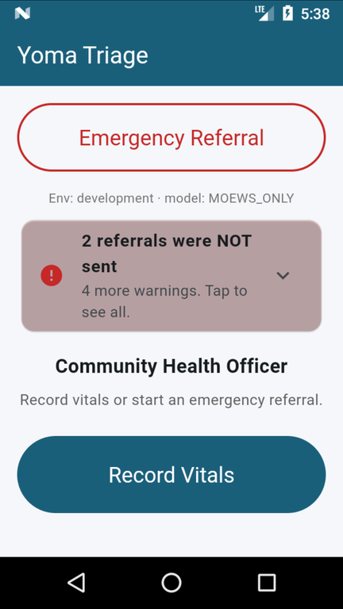 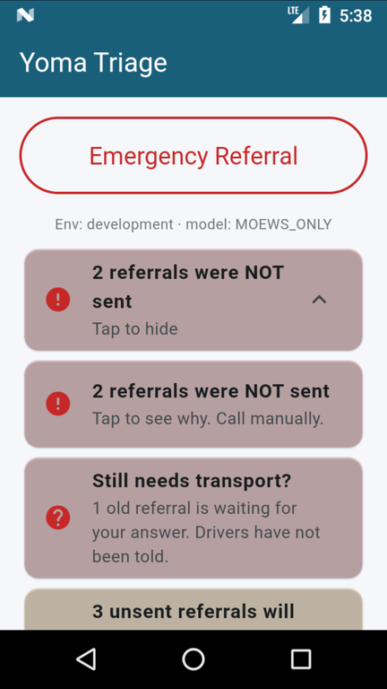 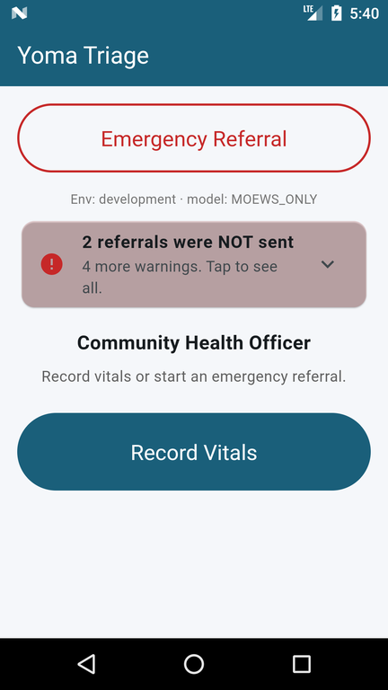

### A3 and A5: release build

- **Refused:** a release with no settings stops with "Refusing to build a release without
  production settings", listing `APP_ENV`, `API_BASE_URL` and `API_KEY`.
- **Test release** (`YOMA_TEST_RELEASE=true`, `http://10.0.2.2:8000`): red label on every
  screen, read by the accessibility tree. Mic denied → INCONCLUSIVE; mic allowed → INCONCLUSIVE
  from YAMNet. Demo strings absent from the compiled Dart.
- **Sizes**, built with `--split-per-abi` and as a bundle:

| Output | Bytes |
|---|---|
| `app-arm64-v8a-release.apk` | 30,101,519 |
| `app-armeabi-v7a-release.apk` | 25,127,819 |
| `app-x86_64-release.apk` | 33,603,765 |
| `app-release.aab` | 64,285,672 |
| Before: one APK | 101,275,955 |

  No `opera_ce_*` file is in any of them. The largest entries left in the x86_64 APK are
  `libflutter.so` 12.3 MB, the compiled Dart 5.9 MB, the TFLite runtime 5.0 MB, YAMNet 3.9 MB and
  the unused TFLite GPU library 3.8 MB.

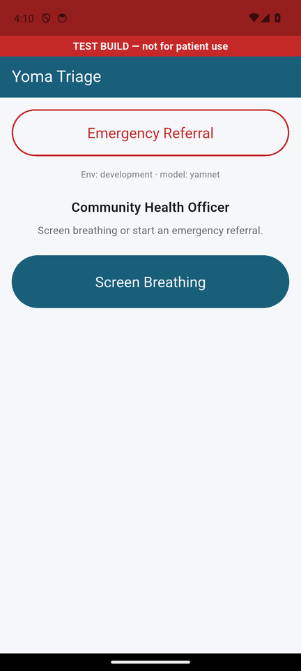

### A4 and B2: scenario 6

- Offline, the referral queues; Call and SMS open the dialler and Messages with the right number
  and text, and no patient name.
- When signal returns, nothing is tapped. The queue sends; the server stores the referral as
  `AWAITING_CONFIRMATION` with no dispatch, because the CHO used Call or SMS (B2). The queued
  screen moves to "Still needs transport?", which says "You used Call or SMS for this referral."
  with Already handled chosen.
- Send now dispatches, and the screen shows TIER1_NOTIFIED.
- A second referral, queued offline with no Call or SMS, dispatches when signal returns, and the
  queued screen moves on to TIER1_NOTIFIED by itself (A4).

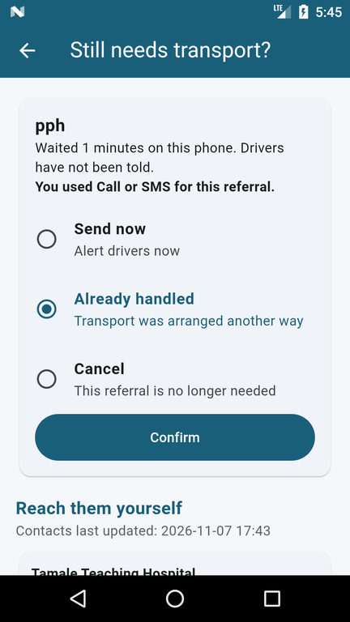 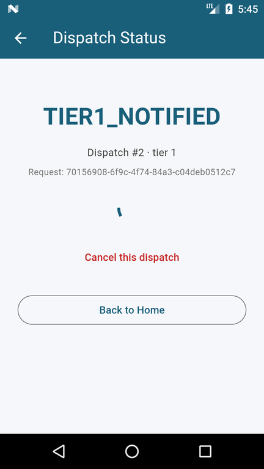

### Timings (full pass)

| Measure | API 34 | API 24 |
|---|---|---|
| Cold start to first frame, release, 5 runs | median 1,738 ms | median 1,175 ms |
| Cold start to Home visible, release (upper bound) | median 4,341 ms | median 2,946 ms |
| Confirm → TIER1_NOTIFIED, release (upper bound) | median 3,375 ms | median 1,805 ms |
| YAMNet load | 658 ms | 282 ms |
| Stale prompt after reconnect | 137 ms | 137 ms |
| Restart → TIER2 on screen | 7,620 ms | 6,801 ms |

API 34 had 3 GB this time, against 4 GB in the original pass, which may explain its slower
YAMNet load and its outlier capture time.

---

# Original pass (`test/emulator-pass`)

Date: 2026-11-07. Base: `origin/main` at `9fe1d01` (batches 3 and 4 merged). Branch: `test/emulator-pass`.

This pass added only tests, a runner script, this document and screenshots. One line of build
config was added to fix a release-build failure: see [B1](#b1-release-build-fails-on-main-fixed-here-one-line).
App behaviour was unchanged. Every other bug below was recorded for a later batch, and batch 5
fixed B2–B8 and B10 (see [the table above](#bugs-from-the-original-pass)).

## Summary

| # | Scenario | API 34 | API 24 (2 GB) |
|---|----------|--------|---------------|
| 1 | YAMNet on a real runtime (BUG-1), OPERA-CE | PASS | PASS |
| 2 | Release build, no demo UI, mic denied → INCONCLUSIVE | PASS | PASS |
| 3 | CHO setup | PASS | PASS |
| 4 | Full referral, USSD accept and arrival | PASS | PASS |
| 5 | Skip vitals | PASS | PASS |
| 6 | Offline: queue, Call and SMS | PASS | PASS |
| 7 | Stale referral prompt | PASS | PASS |
| 8 | Backend restart mid-cascade | PASS | PASS |
| 9 | 320 dp, screens 3–7 | PASS | **FAIL** (s3, s5, s7: Home overflow) |
| 9+ | Home with its warning banners (added test) | **FAIL** at 320 dp, PASS at 411 dp | **FAIL** at 320 dp and at its native 360 dp |

The scenario criteria pass apart from screen size. The pass also found two serious problems
outside the criteria:

- **B2: the app stops responding after every full breath screening.** YAMNet runs on Android's
  main thread for 5.6–6.3 s per 15 s capture. If the CHO touches the screen during that time,
  Android shows "Yoma Triage isn't responding". This reproduced on API 34 every time the probe
  ran, and is likely worse on a slow phone.
- **B3: on a small phone, Emergency Referral can be pushed off Home with no way to scroll to
  it.** This happens when several warning banners are showing, which is when things are going
  wrong. At 360×640 dp, a common low-end size, three banners hide 67 of its 72 dp.

## Devices

There was no physical phone. Both devices are Android emulators on an x86_64 host with KVM,
using software rendering (`-gpu swiftshader_indirect`).

| AVD | Image | RAM | Screen | Notes |
|-----|-------|-----|--------|-------|
| `yoma_api34` | Pixel 6 profile, Android 14 (API 34) google_apis x86_64 | 4 GB, 4 cores (3 GB in the batch 5 rerun, set by the runner, so the host doesn't run out of memory) | 1080×2400 at 420 dpi (411×914 dp) | Created with 2.5 GB, which gave a System UI ANR at boot; raised to 4 GB. |
| `yoma_api24_2gb` | Nexus 5 profile, Android 7.0 (API 24) google_apis x86_64 | 2 GB (2,049,864 kB) | 1080×1920 at 480 dpi (360×640 dp) | |

Small-screen profile (scenario 9): `wm size 640x1136` and `wm density 320`, which gives 320×568 dp.

Toolchain: Flutter 3.44.8 (`~/flutter-3.44.8`, as in `mobile/.metadata`) and JDK 17.

Backend: the real FastAPI app in development mode, with mock SMS (no `AT_API_KEY`). It ran
against a throwaway local PostgreSQL that is migrated, seeded and reset before every scenario.
The test CHO `+233240000777` is registered at compound 1 (Tamale South CHPS) with
`python -m src.admin.add_cho`. The emulator reaches the backend at `10.0.2.2:8000`. No live
Africa's Talking traffic was sent.

## How to rerun

```bash
python3 scripts/run_emulator_pass.py                       # everything, both AVDs (~1 h 40 min)
python3 scripts/run_emulator_pass.py --avd yoma_api34 --scenarios 4 6
python3 scripts/run_emulator_pass.py --scenarios 9          # 320 dp, screens 3–7 and the banner test
```

Options:
- `--scenarios` takes `1`–`9`, `responsive` (A1), `banners` (320 dp), `banners_native` (the
  device's own size), `timings`, or an integration test file name.
- The release is built first, before any emulator boots, and Gradle is stopped before each
  boot, so the two never share the host's memory.
- `--keep-running` leaves the emulators up.

Output goes to `mobile/build/emulator_pass/<avd>/`: `results.json`, one log per test, the
backend log for each test, and every screenshot.

Environment variables: `YOMA_FLUTTER` (default `~/flutter-3.44.8/bin/flutter`), `ANDROID_HOME`
(default `~/Android/sdk`), and `YOMA_PYTHON`, a Python with `backend/requirements.txt` installed
(default `~/.cache/yoma-emulator/venv/bin/python`). PostgreSQL server binaries must be installed
(`/usr/lib/postgresql/*/bin`).

The integration tests are in `mobile/integration_test/`. `support/harness.dart` talks to the
runner's control server on `127.0.0.1:8765` through `adb reverse`, so the tests can reach it even
in airplane mode. The runner uses that channel for screenshots, airplane mode, stopping and
starting the backend, and reading the database. Scenario 2 and the timings drive the release APK
from outside, through `adb` and the accessibility tree, because a release build can't host a
Flutter test.

### Where these results come from

The results come from four runs, all made with the final harness:

- **API 24:** one complete run, 09:00–10:04.
- **API 34, scenarios 1, 2, 6, 9 and the banner tests:** a run at 10:05–10:28.
- **API 34, scenarios 3, 4, 5, 7, 8 and timings:** the earlier complete run, 06:52–07:20. The
  harness changes made after it affect only diagnostics and the reading of external apps, not
  these tests.
- **ANR probe:** counts are summed across the runs that included it.

Two harness bugs were found and fixed during the pass, and the runs above were made after the
fixes:

1. The screen-size reset before shutdown was being lost, which left the next boot at 320 dp.
   The harness now resets and checks the size at boot.
2. The "isn't responding" dialog from the ANR probe stayed on screen and blocked the next test.

## Scenario results

### 1. YAMNet on a real runtime (BUG-1) — PASS on both

Test: `mobile/integration_test/s1_yamnet_test.dart`, built with `MOEWS_ONLY=false`.

- `assets/models/yamnet.tflite` loads in TFLite on the device. The input tensor is `[15600]`
  float32 and the output tensor is `[1, 521]` float32: **521 scores**.
- Four inputs were classified through the app's own `YamnetClassifierIo`:
  - `data/lab_set/synthetic_smoke/abnormal_0.wav`
  - `data/lab_set/synthetic_smoke/normal_0.wav`
  - 8 s of generated silence
  - 8 s of a generated 440 Hz tone

  Every result had `source: yamnet` and model `yamnet-audioset-v0`, so none fell back to the
  stub. Every result was **INCONCLUSIVE** ("No respiratory-class evidence"), never GREEN.
- `createConfiguredClassifier()` picks the real YAMNet when acoustic screening is on.
- **OPERA-CE returns INCONCLUSIVE and doesn't crash.** It fails to load, though; see B4.
- In scenario 2, the release APK with the microphone allowed also gave `INCONCLUSIVE …
  yamnet` from real microphone input (the emulator's silent mic).

What this does **not** show: that YAMNet ever says RED. See B9.

Raw output, the same on both AVDs (class index = score):

| Clip | Top classes | Respiratory classes 36, 37, 39–42 |
|------|-------------|------------------------------------|
| abnormal_0.wav | 35=0.586, 396=0.414, 382=0.199 | all 0 |
| normal_0.wav | 495=0.586, 497=0.414, 132=0.199 | all 0 |
| silence | 494=0.801 | all 0 |
| 440 Hz tone | 495=0.996 | all 0 |

### 2. Release build — PASS on both

Built with `flutter build apk --release --dart-define=MOEWS_ONLY=false` (debug signing), after fix B1.

- **APK size: 96.6 MB** (101,275,955 bytes), a single APK for all ABIs. See B8.
- No demo controls. "Demo Normal", "Demo Code Red", "Web demo simulator" and "Stub classifier"
  are absent from the compiled Dart (`libapp.so`) for every ABI, and absent from every screen
  that was read.
- **Mic denied → INCONCLUSIVE.** The result was "Acoustic (advisory): INCONCLUSIVE — Microphone
  unavailable — use clinical judgment · unavailable". It was never GREEN. The screening screen
  shows raw error text first (B10).
- Mic allowed → `INCONCLUSIVE … yamnet`, so the release build's TFLite and model work end to end.
- Home in a release build shows `Env: development · model: yamnet` (B7).

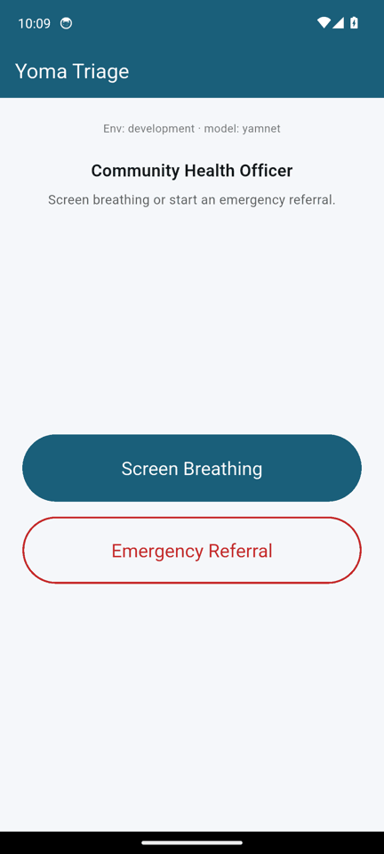 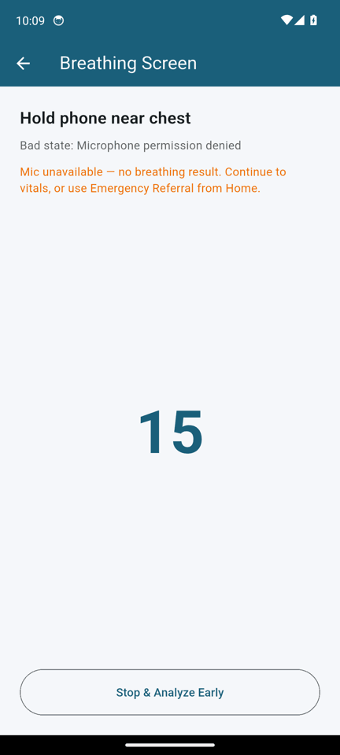 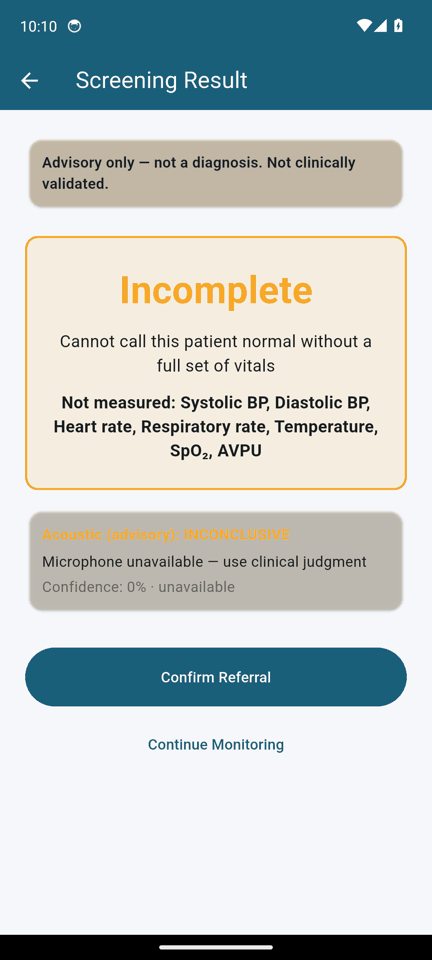 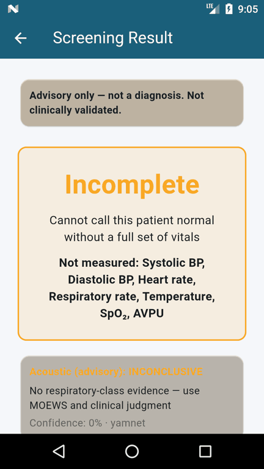

### 3. CHO setup — PASS on both

- An unregistered phone (`+233240999999`) is told: "This phone number is not registered as a
  CHO. Ask your district coordinator to register it."
- The registered phone completes setup. The compound, "Tamale South CHPS", is shown on the
  referral form as the referring location.
- Home itself doesn't name the compound (minor, B11).

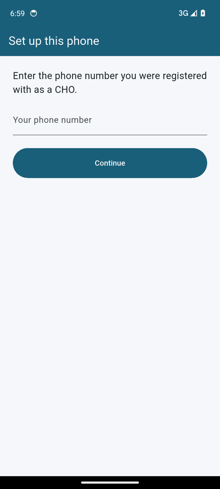 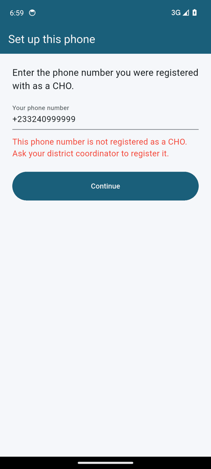 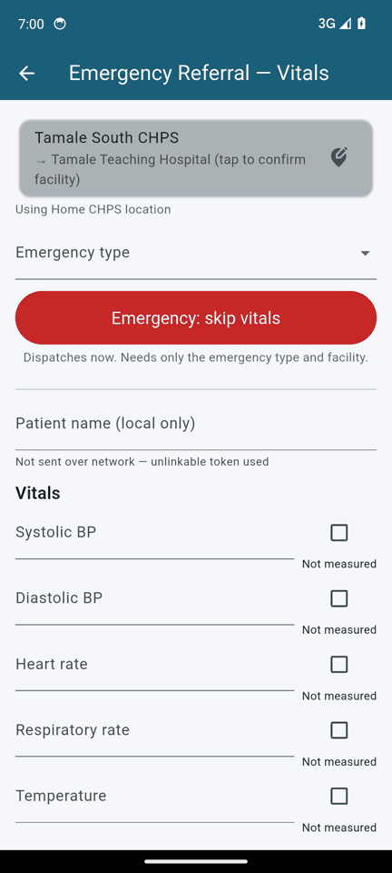

### 4. Full referral — PASS on both

The test entered full vitals, which gave MOEWS RED, then confirmed the referral with a patient
name. Driver accept (`1`) and arrival (`3`) were sent through `POST /api/v1/ussd/callback` as
Motor-King driver `+233240000001`.

- The dispatch screen showed **TIER1_NOTIFIED → HOSPITAL_NOTIFIED (Driver: Ibrahim, ETA 30m) →
  COMPLETED** without being refreshed.
- USSD replies:
  - Accept: "END Accepted! Proceed to CHPS. (Fuel stipend: mock ledger until MoMo is live.)"
  - Arrival: "END Arrival confirmed. Referral complete."
- SMS outbox and dispatch log (mock):

| Purpose | Recipient | Role |
|---------|-----------|------|
| driver_offer | +233240000001, +233240000002 | driver (the two Motor-King drivers) |
| hospital_pre_arrival | +233240000200 | hospital (Tamale Teaching Hospital) |
| cho_arrival | +233240000777 | cho (only the sending CHO) |

The dispatch log (`GET /api/v1/dispatch/{id}/logs`) lists `sms_send` (driver), `ussd_accept`,
`momo_escrow` (MOCK_RECORDED), `hospital_notify` (hospital, MOCKED), `arrival_confirm` and
`cho_arrival_notify` (cho, MOCKED).

The patient name ("Zebra Testpatient") appears in no SMS body and no referral row.

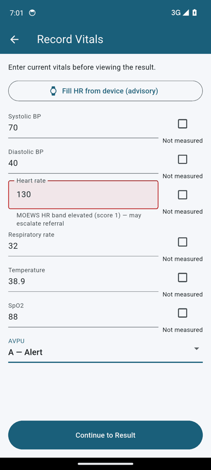  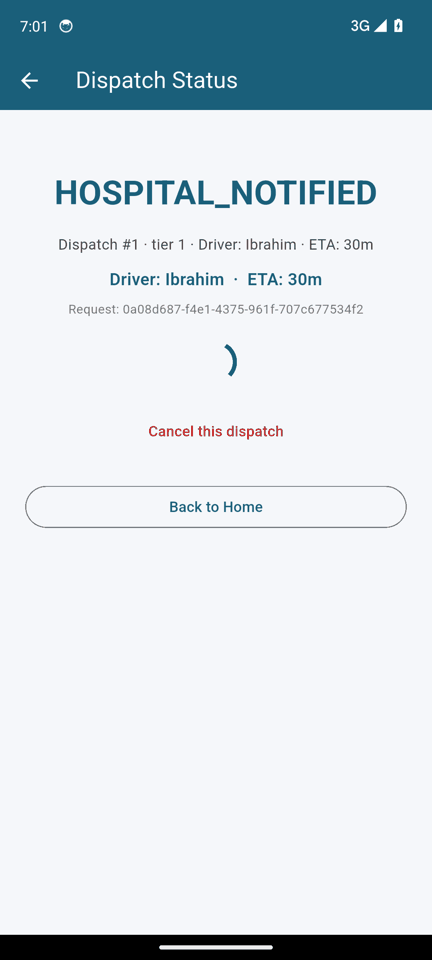 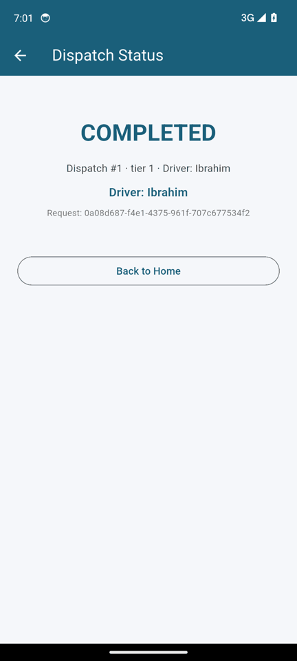

### 5. Skip vitals — PASS on both

"Emergency: skip vitals" dispatches with only the emergency type (postpartum haemorrhage) and
the facility. Stored vitals are all null, with `vitals_taken: false`.

The hospital notice reads:

```
YOMA TRIAGE EMERGENCY REFERRAL
From compound #1
Patient token: c20b183c8978
Condition: pph
Severity: UNKNOWN
Vitals not taken
Driver: Ibrahim
Driver phone: +233240000001
Dispatch: #1
Reply CONFIRM 1 or DIVERT 1 <facility_id>
```

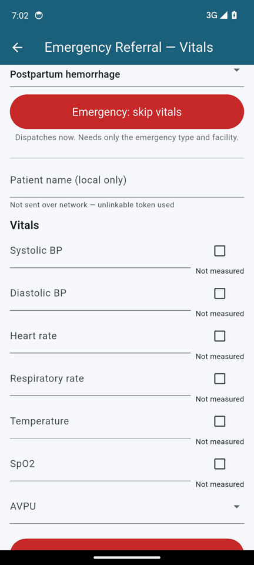 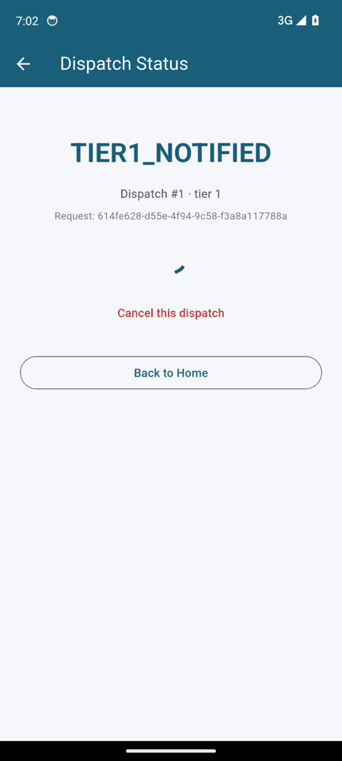

### 6. Offline — PASS on both

The test used real airplane mode, checked by ping.

- The referral queues: "Referral saved on this device. Drivers have not been notified yet."
- Retry sync while offline says "Still waiting for coverage", which can't be mistaken for sent.
- "Reach them yourself" lists the hospital and the three drivers, each with Call and SMS buttons.
- **Call** opens the system dialler with `+233 24 000 0001` already entered:
  - `com.android.dialer` on API 24
  - `com.google.android.dialer` on API 34
- **SMS** opens Messages to `+233 24 000 0001` with the text "Yoma Triage: Emergency transport
  needed at Tamale South CHPS. Please call back now." It contains **no patient name**.
  - On API 24, Android first asked which app to use (Messenger or Hangouts), because two SMS apps
    were installed. That depends on the device, not the app.
- When signal returns, the queue sends by itself. The queued screen doesn't update, though (B5).
- The patient name never reached the server.

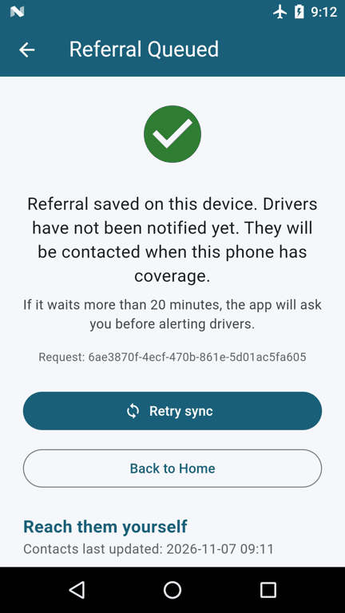 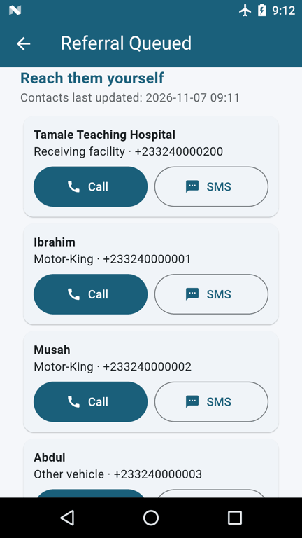 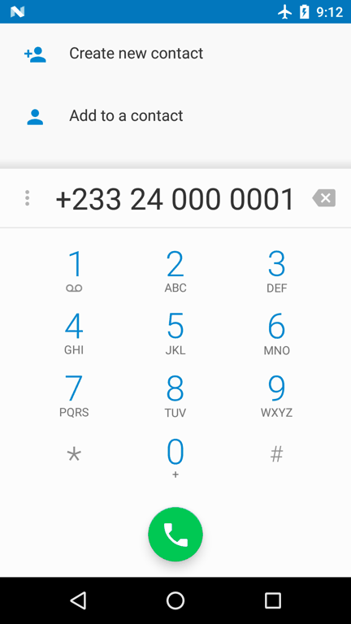 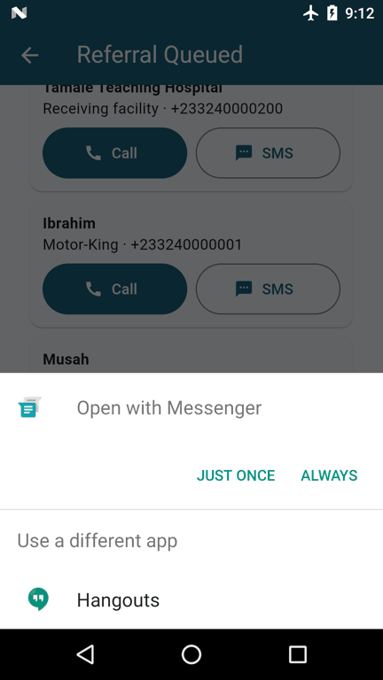 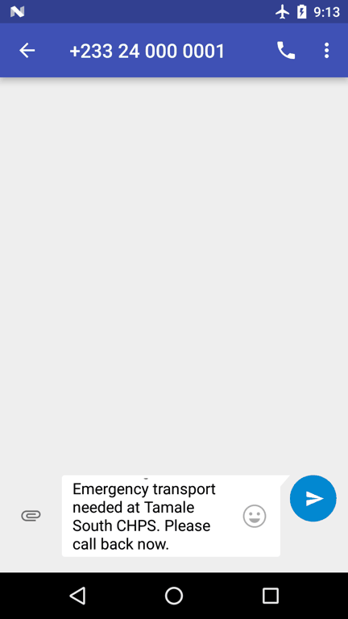 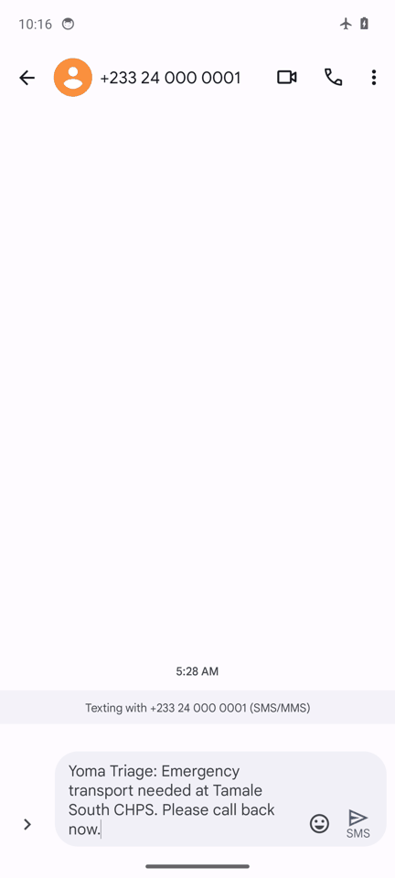

### 7. Stale referral — PASS on both

The backend ran with `STALE_AFTER_MINUTES=1` for this test only; it's a server threshold, so the
app wasn't changed. Three referrals were queued offline, then the test waited 70 s and reconnected.

- The "Still needs transport?" prompt opened on its own, 113–206 ms after the sync.
- All three referrals reached the server as `AWAITING_CONFIRMATION`, aged 73–93 s. No dispatch
  existed before the CHO answered.
- Each answer did the right thing on the server:

| Answer | Referral status | Dispatch | Audit action |
|--------|-----------------|----------|--------------|
| Already handled | MANUALLY_HANDLED | none | referral_already_handled |
| Cancel | CANCELLED | none | referral_cancel |
| Send now | CONFIRMED | one, with driver offers only for it | referral_send_now |

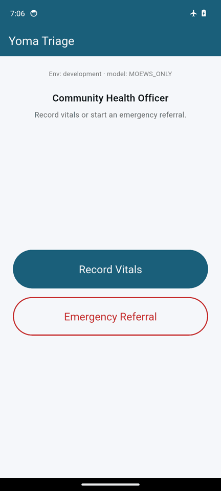 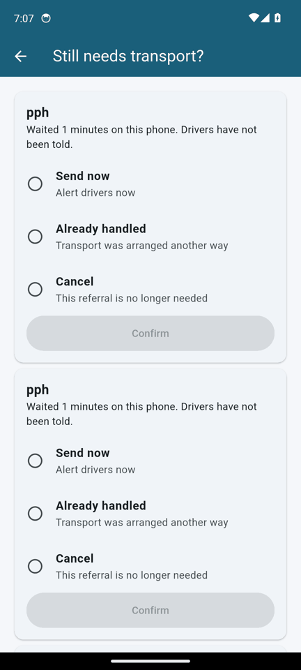 

### 8. Backend restart — PASS on both

The backend ran with `CASCADE_TIER_SECONDS=30` for this test only.

1. The test reached TIER1_NOTIFIED, then sent SIGKILL to the backend and kept it down for 35 s,
   past the tier deadline.
2. While the backend was down, the screen kept the last known status. It also showed raw
   exception text (B6).
3. After a restart, the overdue tier fired, and the screen showed **TIER2_NOTIFIED** 5.3 s
   (API 34) and 6.3 s (API 24) after the restart command.
4. The cascade continued to **FAILED**, and the screen showed the manual contacts.
5. Each driver was offered exactly once (`+233240000001`, `…002`, `…003`), with no repeat after
   the restart. Escalation SMS went to `+233240000100` and to the CHO, `+233240000777`.

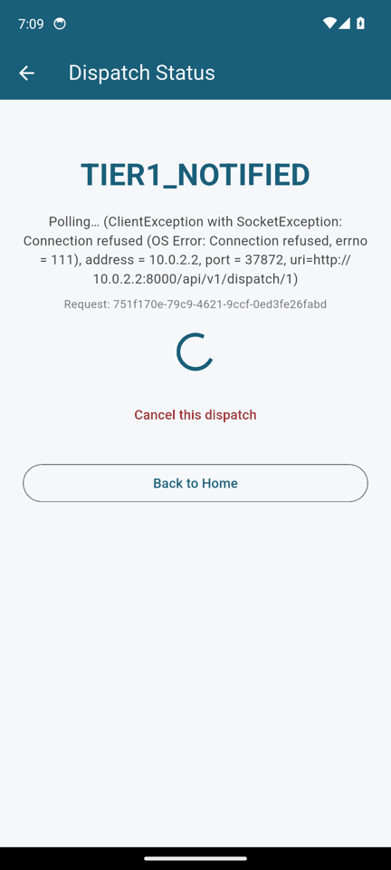 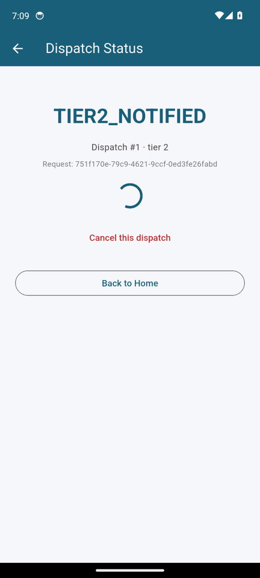 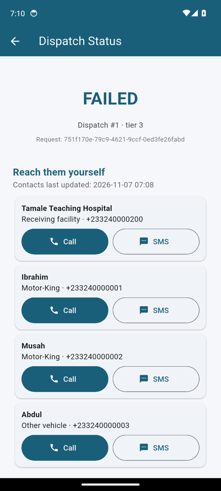

### 9. Small screen (320 dp) — FAIL on API 24, PASS on API 34

Screens 3–7 were rerun at 320×568 dp. Every screen is checked for Flutter layout errors and for
buttons outside the screen.

- **API 34:** no problems. Its gesture navigation leaves 544 dp of height.
- **API 24:** `A RenderFlex overflowed by 15 pixels on the bottom`, at `home_screen.dart:110`.
  It happened in s3, s5 and s7, and not in s4 or s6 (an earlier run also caught it in s4 and s6).
  The screen had 520 dp of height, the keyboard was closed, and one banner was up: "Facility
  catalog may be stale — Using on-device bootstrap". That card is shown until the first catalog
  sync finishes, so the overflow is brief online, but it stays while the catalog is stale and
  the phone is offline. See B3.
- No other screen overflowed or put a button off-screen. Cosmetic problems at 320 dp are in B12.

The added test `s9_home_banners_test.dart` raises Home's own warning banners one at a time. It
sets each banner's real counter on `OfflineQueue.shared`, the same way the app does. It then
measures where Emergency Referral ends against the bottom of the screen:

| Banners up | 320 dp, API 24 (520 dp high) | 320 dp, API 34 (544) | 360 dp, API 24 native (592) | 411 dp, API 34 native (890) |
|------------|---------------------------|----------------------|-----------------------------|-----------------------------|
| none | visible | visible | visible | visible |
| + stale referral | visible | visible | visible | visible |
| + failed referral | **55 dp hidden** | **38 dp hidden** | visible | visible |
| + expiring referral | **191 dp hidden** (whole button) | **174 dp hidden** | **67 dp hidden** | visible |
| + retry warning | **287 dp hidden** | **270 dp hidden** | **139 dp hidden** | visible |

The button is 72 dp tall. The 360 dp screenshots are from a debug build, which draws the
overflow stripes; a release build simply cuts the button off.

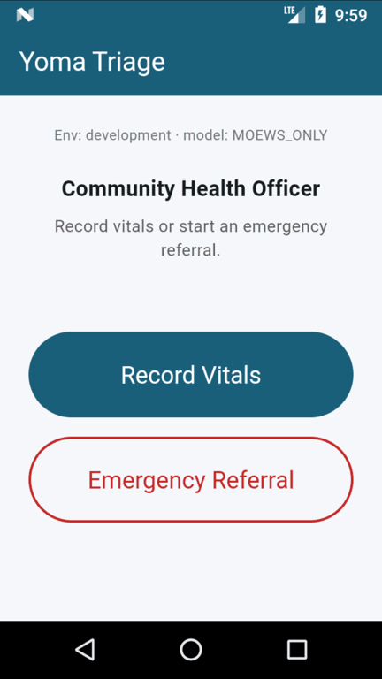 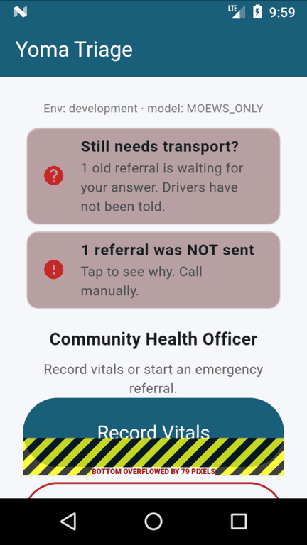 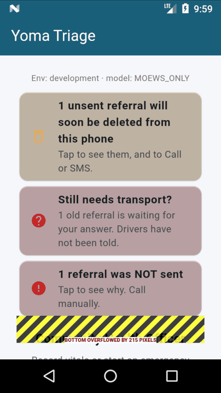 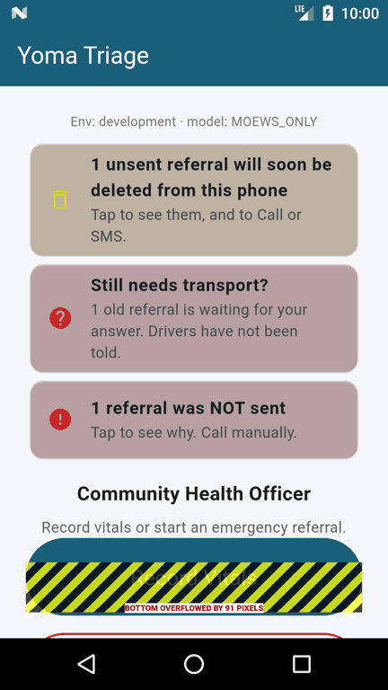 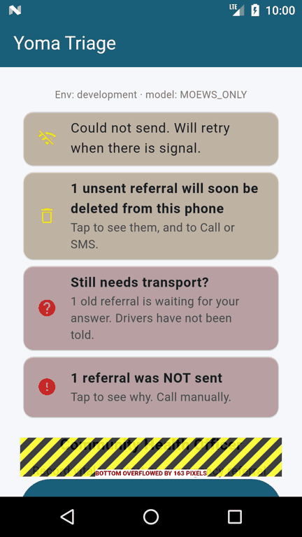

Other 320 dp screens: 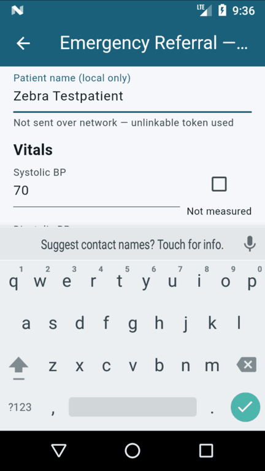 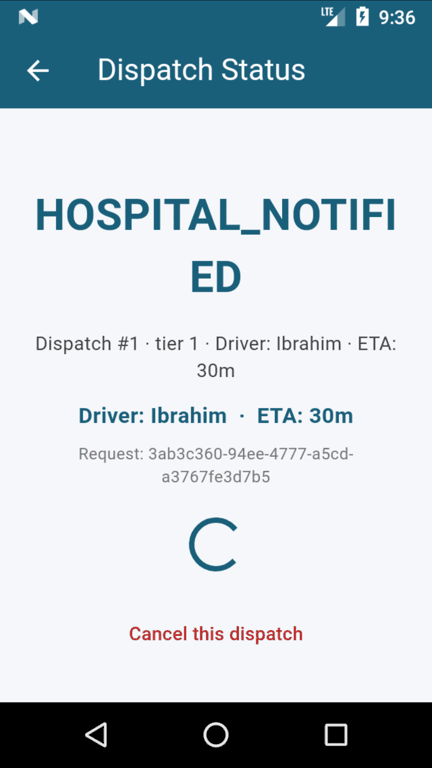 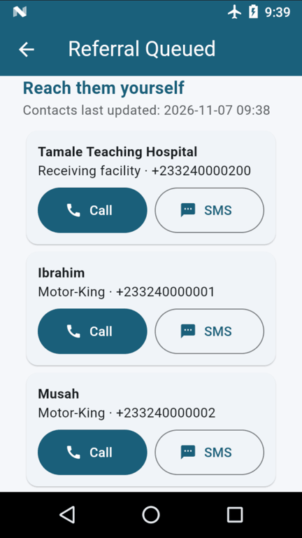 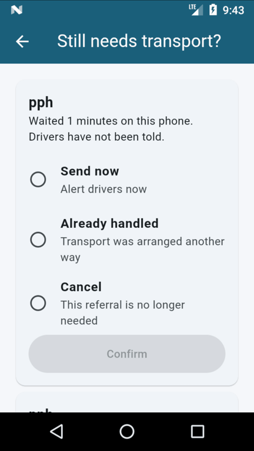

## Timings

An emulator on a desktop CPU with KVM is **not** a low-end phone. Treat these figures as
relative, and as a lower bound for a budget phone.

| Measure | API 34 | API 24 (2 GB) |
|---------|--------|---------------|
| Cold start to first frame (`am start -W`, release, 5 runs) | median 1,822 ms (1,725–3,713) | median 1,133 ms (1,088–1,238) |
| Cold start to Home visible (release, 5 runs; upper bound) | median 4,322 ms (4,169–6,602) | median 3,048 ms (2,942–3,128) |
| YAMNet load | 228–257 ms | 232–337 ms |
| YAMNet, per 8 s clip (4 clips, 3 runs) | typically 2.7–3.0 s; outliers 4.3, 5.0, 5.6, 6.5 s | typically 2.8–3.3 s; outliers 4.3, 6.9 s |
| **YAMNet, full 15 s capture (what the app records), 6 runs** | **5.56–5.78 s** | **5.63–6.34 s** |
| Confirm Referral → TIER1_NOTIFIED on screen, release (3 runs; upper bound) | median 3,237 ms (3,229–3,679) | median 1,840 ms (1,817–1,840) |
| Same, debug build, measured inside the test | 545 ms | 875 ms |
| Stale prompt after reconnect | 189 ms | 132 ms |
| Restart → TIER2 on screen | 5,292 ms | 6,327 ms |

Notes:
- "Home visible" and the release Confirm figures are measured by reading the screen from outside
  through the accessibility tree. Each read takes 1–2 s, more on API 34, so these are upper
  bounds, and that's why API 34 looks slower than API 24 here. The in-test debug figure is the
  direct measurement.
- API 34's first frame is slower than API 24's. The likely cause is software rendering at
  1080×2400 on a heavier system image. Both run on the same host CPU.

## Bugs found

They are in order of severity. All were left for a later batch except B1.

### B1. Release build fails on main (fixed here, one line)

`flutter build apk --release` fails on a clean checkout of `9fe1d01`. R8 stops on a missing class:

```
ERROR: R8: Missing class org.tensorflow.lite.gpu.GpuDelegateFactory$Options
(referenced from: void org.tensorflow.lite.gpu.GpuDelegate.<init>() and 1 other context)
```

The `tflite_flutter` plugin references the optional GPU delegate's options class, and the
dependency that defines it isn't on the classpath. The fix is a new
`mobile/android/app/proguard-rules.pro`, which Flutter's Gradle plugin picks up by this name,
containing one line:

```
-dontwarn org.tensorflow.lite.gpu.GpuDelegateFactory$Options
```

It's in a commit of its own on this branch. Without it, scenario 2 couldn't run. A later batch
might prefer to add the GPU delegate dependency, or to drop GPU support from the build.

### B2. Breath screening blocks the main thread past Android's ANR limit (high)

`YamnetClassifierIo.classifyPcm16kHzMono` (`mobile/lib/services/yamnet_classifier_io.dart`)
runs every 0.975 s window of the capture through `_interpreter.run` in one synchronous loop.
A 15 s capture is about 29 windows. Flutter 3.44 runs Dart on Android's main thread, so for the
whole analysis:

- the screen is frozen, and the "analysing" animation doesn't move;
- touches aren't answered.

Measured:
- **5.56–6.34 s per full capture** on the emulators (table above).
- Android raises an ANR when a touch waits 5 s. The probe in `scenario_2` (`anr_probe` in the
  runner) touches the app bar, which has no action, once a second during analysis, with error
  dialogs showing. On API 34, Android logged `am_anr` for Yoma in **7 of 8 probe runs**, and
  showed **"Yoma Triage isn't responding — Close app / Wait"**.
- The first time, it happened during scenario 2 itself. The harness hides error dialogs, so
  Android killed the app instead of asking, and the test found the launcher.
- On API 24 (Android 7.0) the probe logged no ANR in 6 runs, although the analysis takes as long.
  The reason wasn't established.

Evidence:
- ANR trace from `/data/system/dropbox/data_app_anr@…` on the API 34 AVD: `Subject: Input
  dispatching timed out (… gh.yomatriage.yoma_triage/.MainActivity … Waited 5002ms for
  MotionEvent …)`. The `"main"` thread is `state=R`, in `TfLiteInterpreterInvoke`.
- Screenshot: 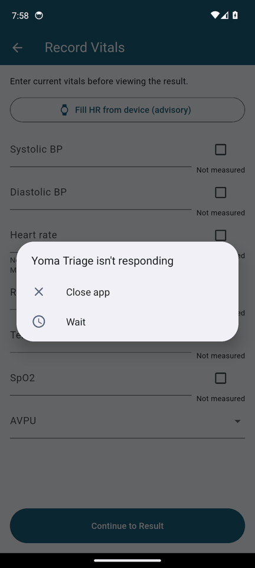, from the 07:58 run.

A budget phone with a slower CPU will take longer than these emulators, so a CHO who touches the
screen while waiting is likely to see the dialog. "Close app" loses the screening result.

The direction of a fix is to run inference off the main isolate, for example with `tflite_flutter`'s
`IsolateInterpreter` or `Isolate.run`. It wasn't changed here, because this pass is test-only.

### B3. Home doesn't scroll, so its banners can push Emergency Referral off the screen (high)

`HomeScreen.build` (`mobile/lib/screens/home_screen.dart:110`) is a fixed `Column` with `Spacer`s
and no scrolling. The warning cards appear when something has gone wrong:

- retry warning;
- referrals about to expire;
- stale referrals awaiting an answer;
- failed referrals;
- stale facility catalog.

Each card takes height from the same column as the two main buttons. On a 360×640 dp phone,
three cards hide all but 5 dp of **Emergency Referral**, and there's no way to scroll to it. At
320 dp, two cards are enough to cut it off. Table and screenshots in scenario 9.

The 15 px overflow seen in scenario 9 is the same bug with only the "Facility catalog may be
stale" card up.

### B4. OPERA-CE encoder fails to load, and the app says it isn't installed (medium)

`assets/models/opera_ce_encoder.tflite` is bundled and loads as an asset (8,040,904 bytes).
`Interpreter.fromAsset` then throws `Bad state: failed precondition` on both AVDs. The
classifier returns INCONCLUSIVE, model `opera_ce-pending`, with the reason "opera_ce encoder pack
not installed — use MOEWS and clinical judgment"
(`mobile/lib/services/opera_ce_classifier_io.dart:218`).

The result is safe, because it's INCONCLUSIVE and nothing crashes. The reason is misleading,
though: the pack *is* installed, and it's the model that fails, perhaps because of an op or
version the bundled TFLite runtime lacks. Anyone selecting `SCREENING_MODEL=opera_ce` gets no
acoustic result.

### B5. The queued screen says drivers weren't notified after it has sent (medium)

In scenario 6, the test stayed on "Referral Queued" while signal returned. The queue sent the
referral by itself, and the dispatch existed on the server with offers out. The screen still
said "Drivers have not been notified yet … Still waiting for coverage" until the CHO tapped
Retry sync, which then went to the dispatch screen. This happened on both AVDs.

A CHO could phone drivers who have already been offered the trip, or not know the referral went.

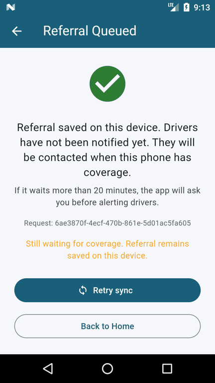

### B6. Raw exception text on the dispatch screen (medium)

While the backend is down, `dispatch_status_screen.dart:163` shows `'Polling… ($e)'`. In use
that reads:

> Polling… (ClientException with SocketException: Connection refused (OS Error: Connection
> refused, errno = 111), address = 10.0.2.2, port = 37872, uri=http://10.0.2.2:8000/api/v1/dispatch/1)

It should be a plain message, such as "Can't reach the server. Retrying…".

### B7. A release build defaults to development settings (medium)

`AppEnvironment.name` defaults to `development` (`mobile/lib/config.dart:79`), so a release
built without `--dart-define=APP_ENV=production` shows "Env: development · model: yamnet" on
Home. That was seen here.

From reading the code, not from a phone: `ApiConfig.baseUrl` (`config.dart:14–24`) falls back to
`http://10.0.2.2:8000` on Android when `API_BASE_URL` isn't defined. On a real phone that address
goes nowhere, so a release built without it can't send referrals. A later batch could make the
release build fail, or the app refuse to start, without these defines.

### B8. APK is 96.6 MB, with an unused 15.6 MB model (medium for the target phones)

The release APK is one file for all three ABIs. Its largest entries:

| Size | Entry |
|------|-------|
| 15.6 MB | `assets/flutter_assets/assets/models/opera_ce_encoder.onnx` (the app has no ONNX runtime) |
| 12.3 / 11.0 / 8.1 MB | `libflutter.so` for x86_64 / arm64-v8a / armeabi-v7a |
| 7.7 MB | `opera_ce_encoder.tflite`, which doesn't load (B4) |
| 3.8 MB | `libtensorflowlite_gpu_jni.so` per ABI (the GPU delegate isn't used) |

Splitting per ABI (`--split-per-abi`) and dropping the `.onnx` would roughly halve the download.
That matters for CHOs on prepaid data.

### B9. YAMNet's RED path was never exercised (medium, evidence gap)

Every input, including `abnormal_0.wav`, scored exactly 0 on the respiratory classes the app uses
(36, 37, 39–42). All scores come out in steps of 1/256 (0.5859, 0.4141, 0.1992, 0.0039), though
the output tensor is float32. The model seems to be quantised, so weak evidence rounds to 0 and
reads as "no respiratory evidence". The clips in `data/` are synthetic (`synthetic_smoke`), not
breath sounds.

So nothing here shows YAMNet can return RED for a real cough or wheeze. A later batch needs real
recordings, and should check whether a quantised model is intended.

### B10. Raw microphone error on the screening screen (low)

With the mic denied, the screen shows `Bad state: Microphone permission denied` above the proper
message. It comes from `StateError` in `audio_recorder_io.dart:28`, shown through
`e.toString()` at `screening_screen.dart:55`.

### B11. Home doesn't show which compound the phone is set up for (low)

After setup, the compound appears on the referral form but not on Home. A CHO sharing or
borrowing a phone can't tell which CHPS it will refer from without opening a referral.

### B12. Cosmetic, seen at 320 dp (low)

- The dispatch screen shows raw status codes (`TIER1_NOTIFIED`, `HOSPITAL_NOTIFIED`). At 320 dp
  `HOSPITAL_NOTIFIED` breaks mid-word as "HOSPITAL_NOTIFI / ED".
- The stale prompt says "Waited 1 minutes on this phone".
- On the result screen, the "Acoustic (advisory): INCONCLUSIVE" heading is yellow on beige, which
  is hard to read.

## What still needs a physical phone

- **Speed on a real budget phone** (ARM, 1–2 GB, Android 8–11): cold start, and especially
  YAMNet time per 15 s capture, which decides how bad B2 is. The emulators run on a desktop CPU.
- **The real microphone**: real breath and cough recordings through the app, for B9. The
  emulator's mic is silent.
- **Call and SMS on a phone with a SIM**: that the call is placed and the SMS sends from the
  phone's own Messages app, including on a dual-SIM phone and with a default-SMS-app chooser. On
  the emulators both opened with the right number and text, but nothing was sent.
- **Real loss of coverage**, rather than airplane mode: weak or flapping 2G/3G, captive portals,
  and the app sent to the background or killed while a referral is queued.
- **Screen sizes and font scaling** on actual small phones, including Android's large-text
  setting, which makes B3 worse.
- **Battery and memory pressure** on a 1–2 GB phone, with other apps open.

## What still needs real Africa's Talking

The pass ran against mock SMS only. Still to check with a sandbox or a live account:

- **SMS delivery** to the driver, hospital and CHO numbers, delivery reports, and what
  `UNDELIVERABLE` handling does with real failures.
- **USSD from a real handset**: the driver menu over the real session flow (session IDs,
  timeouts, `CON`/`END` handling). This pass called `/api/v1/ussd/callback` directly with the
  same payload shape.
- **Hospital replies** "CONFIRM n" and "DIVERT n …" arriving as inbound SMS. The hospital-confirm
  step was not simulated here; the brief asked for accept and arrival only.
- **Sender ID and short code** behaviour on Ghanaian networks (MTN, Telecel, AT), and the SMS
  length of the hospital notice, which is 224 characters (two segments).
- **MTN MoMo**: the fuel stipend shows "mock ledger until MoMo is live".

## Files added

- `mobile/integration_test/`:
  - `s1_yamnet_test.dart`
  - `s3_setup_test.dart`
  - `s4_full_referral_test.dart`
  - `s5_skip_vitals_test.dart`
  - `s6_offline_test.dart`
  - `s7_stale_test.dart`
  - `s8_restart_test.dart`
  - `s9_home_banners_test.dart`
  - `s10_responsive_test.dart` (added in batch 5)
  - `support/harness.dart`
- `scripts/run_emulator_pass.py`: the one-command runner.
- `mobile/pubspec.yaml`: adds `integration_test` (Flutter SDK) as a dev dependency.
  `mobile/pubspec.lock` gains only the packages that brings in (`flutter_driver`,
  `fuchsia_remote_debug_protocol`, `integration_test`, `process`, `sync_http`, `webdriver`).
  No existing versions changed.
- `mobile/android/app/proguard-rules.pro`: the one-line fix for B1.
- `docs/testing/EMULATOR_PASS.md` and `docs/testing/screenshots/`.
